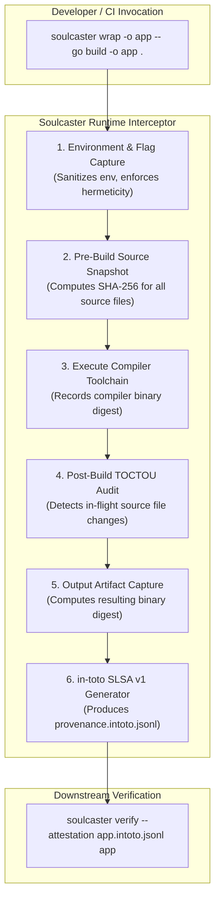

# Soulcaster 🔮

> **Runtime Hermetic Compiler Attestation & in-toto SLSA Level 3 Provenance**  
> *Part of the `bonjoski` Sovereign AI Agent Security Toolchain*

---

## Overview

Existing supply-chain security tools (like SBOM generators or static binary scanners) only inspect artifacts *post-build*. This leaves a critical vulnerability window: **ephemeral build-time tampering** — including in-memory compiler hijacking, source file swapping during compilation (TOCTOU attacks), and non-hermetic remote network fetches inside CI runners.

`Soulcaster` wraps your build toolchain (`go build`, `cargo`, `clang`, `rustc`, `gcc`), capturing input source files, compiler binary digests, environment flags, and resulting artifacts to generate cryptographically verifiable **in-toto v1.0 Statements** with **SLSA v1.0 Provenance predicates**.

---

## Features

- **Compiler Wrapping (`soulcaster wrap`)**: Transparently intercepts compiler invocations (`go build`, `make`, etc.).
- **TOCTOU Defense**: Takes cryptographic pre-build source snapshots and re-verifies all input digests immediately post-build to detect in-flight source swapping or backdoor injections.
- **Hermeticity Enforcement**: Blocks external network egress (`GOPROXY=off`, `GOSUMDB=off`) and records network activity indicators.
- **in-toto v1.0 & SLSA v1.0 Compliant**: Outputs machine-verifiable attestation JSONL files matching SLSA Provenance v1 specifications.
- **Attestation Verifier (`soulcaster verify`)**: Re-hashes output binaries and validates against recorded attestation digests, immediately rejecting tampered binaries.

---

## Quickstart

### 1. Build a Binary with Soulcaster Wrap

```bash
soulcaster wrap -o bin/myapp -- go build -o bin/myapp ./cmd/myapp
```

This compiles your application and produces:
1. `bin/myapp` (compiled executable)
2. `bin/myapp.intoto.jsonl` (in-toto SLSA provenance attestation)

### 2. Verify Binary Integrity

```bash
soulcaster verify --attestation bin/myapp.intoto.jsonl bin/myapp
```

Output:
```text
[PASS] Hermeticity Verified: 12 source files, 0 network calls, SLSA Level 3 compliant.
  Binary:           /path/to/bin/myapp
  Digest:           821bc211ef5414a59167749507eadd68fa216ddd30e6d3117ea613b335c54e93
  Attestation:      bin/myapp.intoto.jsonl
  Source Files:     12 checked
  Hermetic Mode:    true
```

If the binary or any tracked source file was tampered with, verification immediately halts with non-zero exit status:
```text
[FAIL] verification failure: binary "myapp" has been tampered with or modified post-attestation
  TAMPERED BINARY DETECTED! Computed SHA-256 (46b8...) does not match attestation (821b...)
```

---

## Architecture & Dataflow



---

## Roadmap

- [x] Phase 0: 4-Hour MVP Spike (CLI wrapper, in-toto v1.0 Statement & SLSA v1.0 Provenance, verifier, TOCTOU defense).
- [ ] Phase 1: Real-Time Syscall File Tracker (`fanotify` on Linux, Endpoint Security / Seatbelt on macOS).
- [ ] Phase 2: Locksmith Biometric Hardware Signing & Cosign Keyless OIDC integration.

---

## License

Apache-2.0
