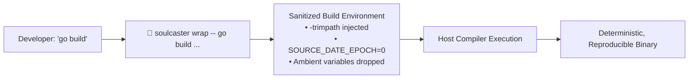

# Recipe: Hermetic Compiler Wrapping

> **Use Case ID:** `SOU-UC-01`  
> **Target Audience:** Build Engineers, Release Managers, DevSecOps  
> **Platform Mechanism:** Process Isolation & Environment Scrubbing  

---

## 1. Problem Statement

Standard compiler invocations (`go build`, `cargo build`, `clang`) capture ambient host environment details: local absolute file paths (`/Users/username/...`), ambient timestamps, user IDs, and environment variables. This prevents bit-for-bit reproducible builds and leaks developer workstation paths into production binaries.

---

## 2. When to Use This

Use **`soulcaster wrap`** to wrap any compiler invocation during local development or CI releases. Soulcaster injects `-trimpath`, normalizes timestamps (`SOURCE_DATE_EPOCH`), isolates temporary build directories, and guarantees reproducible compilation.

---

## 3. Architecture & Dataflow



---

## 4. Prerequisites

1. **Soulcaster Installed:** `brew install bonjoski/tap/soulcaster` (or built from source).

---

## 5. Step-by-Step Recipe

### Step 1: Wrap Go Compilation
```bash
soulcaster wrap -o bin/myapp -- go build -o bin/myapp ./cmd/myapp
```

### Step 2: Wrap Rust / Cargo Compilation
```bash
soulcaster wrap -o target/release/mycrate -- cargo build --release
```

---

## 6. Verification & Expected Output

Verify binary bit-for-bit reproducibility:
```bash
shasum -a 256 bin/myapp
```
Compiling the same source tree on any identical architecture produces the exact same SHA-256 digest.

---

## 7. Security Invariants & Blast Radius

- **Stripped Ambient Paths:** Workstation paths like `/Users/username/code/...` are stripped from the DWARF symbol tables.
- **Fail-Closed on Unpinned Compilers:** Warns if compiler version is not pinned in lockfiles.

---

## 8. Troubleshooting & Common Pitfalls

- **Issue:** Compiler fails looking for custom library path.  
  **Remediation:** Whitelist specific build environment variables with `--allow-env`:
  ```bash
  soulcaster wrap --allow-env CGO_CFLAGS -- go build ...
  ```
