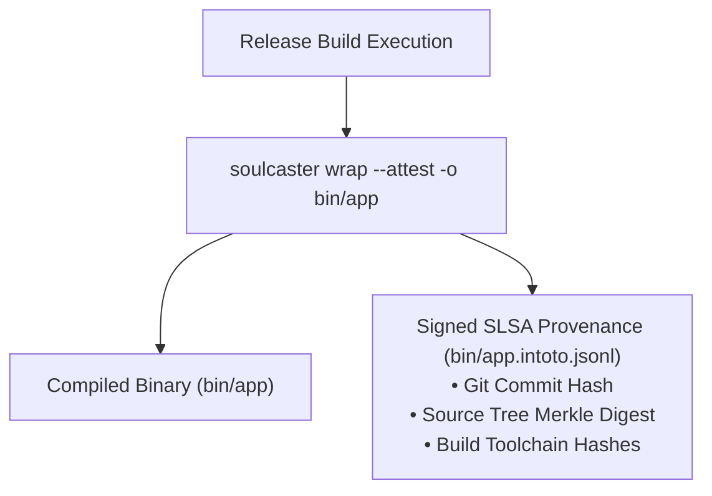

# Recipe: Generating SLSA Level 3 Provenance Attestation

> **Use Case ID:** `SOU-UC-02`  
> **Target Audience:** Release Engineers, Open-Source Maintainers, Compliance Officers  
> **Platform Mechanism:** in-toto / SLSA v1.0 Attestation Engine  

---

## 1. Problem Statement

To satisfy enterprise supply chain security requirements (Executive Order 14028, NIST SSDF), release artifacts must be accompanied by cryptographic provenance proving *how*, *where*, and from *which source commit* the binary was built.

---

## 2. When to Use This

Use **Soulcaster Provenance Generation** during release builds. Soulcaster generates an in-toto formatted JSON Lines file (`.intoto.jsonl`) capturing Git commit SHA, compiler flags, source tree digest, and build environment metadata, signed with local developer keys or Sigstore Cosign.

---

## 3. Architecture & Dataflow



---

## 4. Prerequisites

1. **Soulcaster CLI:** Version 1.0+ on `$PATH`.
2. **Git Repository:** Clean working tree recommended for release builds.

---

## 5. Step-by-Step Recipe

### Step 1: Compile Binary with Attestation
```bash
soulcaster wrap \
  --attest \
  --out bin/myapp \
  --predicate-out bin/myapp.intoto.jsonl \
  -- go build -o bin/myapp ./cmd/myapp
```

---

## 6. Verification & Expected Output

Inspect the generated provenance predicate:
```bash
cat bin/myapp.intoto.jsonl | jq .
```
Expected output:
```json
{
  "_type": "https://in-toto.io/Statement/v1",
  "subject": [
    {
      "name": "bin/myapp",
      "digest": {
        "sha256": "8f3e2a1b9c..."
      }
    }
  ],
  "predicateType": "https://slsa.dev/provenance/v1",
  "predicate": {
    "buildDefinition": {
      "buildType": "https://github.com/bonjoski/soulcaster/build/v1",
      "externalParameters": {
        "command": "go build -o bin/myapp ./cmd/myapp"
      }
    }
  }
}
```

---

## 7. Security Invariants & Blast Radius

- **Tamper Evidence:** If the binary is modified by even a single byte after compilation, the cryptographic subject digest mismatch causes verification to fail.

---

## 8. Troubleshooting & Common Pitfalls

- **Issue:** Dirty working tree warning.  
  **Remediation:** Commit all staged changes before running release attestation, or pass `--allow-dirty` for local development.
