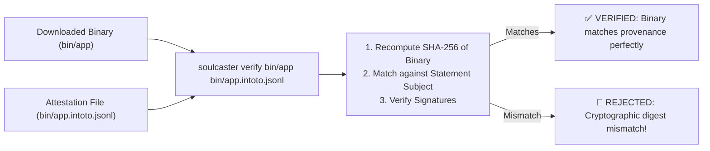

# Recipe: Offline Provenance & Integrity Verification

> **Use Case ID:** `SOU-UC-03`  
> **Target Audience:** Consumers, System Administrators, Security Auditors  
> **Platform Mechanism:** Standalone Provenance Verifier  

---

## 1. Problem Statement

Before executing a downloaded CLI binary or deploying an artifact to production, consumers need to verify that the binary was not tampered with, that its SHA-256 matches its signed attestation, and that it originated from the expected Git repository.

---

## 2. When to Use This

Use **`soulcaster verify`** to validate a binary against its `.intoto.jsonl` attestation file offline on any machine, without requiring internet access or third-party cloud trust brokers.

---

## 3. Architecture & Dataflow



---

## 4. Prerequisites

1. **Soulcaster:** Version 1.0+ on `$PATH`.

---

## 5. Step-by-Step Recipe

### Step 1: Verify Binary Integrity
```bash
soulcaster verify bin/myapp bin/myapp.intoto.jsonl
```
Expected output:
```text
✅ PROVENANCE VERIFIED
   • Subject:   bin/myapp (SHA-256: 8f3e2a1b9c...)
   • Type:      SLSA v1.0 Provenance
   • Builder:   soulcaster/v1.0 (Hermetic)
   • Git Repo:  github.com/bonjoski/myapp (Commit: 9b956f2)
   • Status:    AUTHENTIC & UNTAMPERED
```

---

## 6. Verification & Expected Output

Simulate a tampering attack by modifying a single byte in the binary:
```bash
echo "tamper" >> bin/myapp
soulcaster verify bin/myapp bin/myapp.intoto.jsonl
```
Expected output:
```text
🚨 PROVENANCE VERIFICATION FAILED!
Subject digest mismatch:
   Expected: 8f3e2a1b9c...
   Actual:   42b109e8f1...
Exit code: 1.
```

---

## 7. Security Invariants & Blast Radius

- **Offline Independence:** Verification does not query any external network endpoint or certificate authority.

---

## 8. Troubleshooting & Common Pitfalls

- **Issue:** Attestation file format unrecognized.  
  **Remediation:** Verify that the attestation adheres to the in-toto v1 Statement specification.
